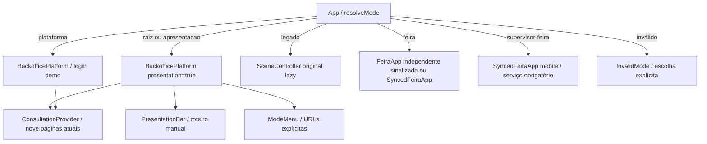

# Arquitetura e dependências

## Roteamento atual — nova apresentação padrão (19/10/2026)

App seleciona o modo por `src/modes.js` (função pura resolveMode). Raiz e ?modo=apresentacao montam BackofficePlatform com presentation=true; ?modo=plataforma mantém acesso demo livre. SceneController é lazy e montado somente em ?modo=legado; seu arquivo/configuração/consumidores não mudam. Feira/serviço/Supervisor conservam a seleção anterior (config local ou parâmetro de sessão), motor e contratos existentes. Modo inválido/vazio/duplicado mostra escolha segura.

Responsabilidades: `src/presentation/itinerary.js` define nove IDs/purposes a partir do catálogo existente; PresentationBar só altera o hash por clique/teclado nativo dos botões. PlatformShell mantém um único listener de hash e o provedor existente; presentation filtra o menu para páginas implementadas, identifica o roteiro e dispensa login sem escrever sessionStorage. Indicadores/dados/fórmulas/componentes de páginas não são duplicados. Troca de tela preserva consulta; refresh e troca de modo mantêm os contratos de inicialização existentes. ModeMenu comunica fontes e limites; não faz descoberta de rede, ponte contextual ou transferência de dados entre modos.

Deep links usam #/visao-geral etc.; legado usa ?modo=legado#/1–#/10. Hash inválido ou fora do roteiro permite retorno manual ao início e não monta o legado. Raiz serve assets/JSONs empacotados estáticos sob base /OrquestraNEXT; não consulta API5180. Nenhuma alteração em vite.config.js. Links denominados Apresentação original, inclusive fallback/footer Feira e acesso local, agora levam ao legado explícito. Alterações nesses consumidores são somente URLs, sem mexer no protocolo SSE/POST ou política de reprodução.

Decisão19/10: reutilizar BackofficePlatform por prop de apresentação em vez de montar um segundo roteador/provedor ou adaptar SceneController. Motivo: mesmas telas e contexto de filtros, isolamento do legado, fonte histórica estável e nenhuma dependência de timers. Consequência: apresentação e Plataforma compartilham layout/serviços e diferem em acesso/menu/controles; ambas recebem teste de regressão. Ajuste responsivo do cabeçalho acomoda o seletor em celular. Sem ADR separado para essa adaptação contida no escopo aprovado.

Contratos de produto em [modos](../produto/modos.md); resultados/arquivos/testes em [relatório da apresentação](../produto/entrega-apresentacao-padrao.md). Integração autoritativa permanece no contrato técnico do Supervisor.

## Mapeamento inicial preservado

As seções abaixo registram a análise inicial, anterior às entregas da Plataforma e Feira. Não descrevem o estado atual de App/serviço. Stack permanece React/React DOM, Vite, ES Modules e CSS Modules; fontes de dados/backend vigentes estão na continuidade e nos contratos específicos.

## Grafo funcional

- SceneController → scenes.config, sceneIndex, CSS do palco → views/**/index.jsx via lazy/Suspense.
- BackofficeView → Sidebar, TopHeader, telas e metadados; navegação por estado.
- ChamadosScreen → chamadosData → fila, fluxo, alertas, feed e detalhe.
- Cenas Supervisor → QuadroSupervisor → header/CSS Supervisor/barra tutorial.
- CenaTransicao → listas, CardTransicao, useRoteiro, useFlip.
- DetalheDoTutorial → ChamadoDetalheView por props, mantendo lookup legado como fallback.
- AvisoCritico → alerta, detalhe, modo risco/crítico e CSS.

## Reuso e manutenção

| Grupo | Dependências | Encaminhamento |
| --- | --- | --- |
| Sidebar/TopHeader/SectionCard | menu, metadados, CSS | Reusar; conectar busca/período na Plataforma |
| KpiCard/AnimatedKpi/AnimatedNumber | props, timeout/RAF | Reusar; explicação e fonte por composição |
| DataTable/BarChart/LineChart | props/SVG | Reusar; paginação, vazio e drill-down conforme necessidade |
| Badge/PrioridadeBadge/SlaBar/ProgressBar | enums e escala | Adapter validado; não recalcular criticidade arbitrariamente |
| FilaChamados/AlertasSla/FeedEventos/DetalheChamadoPanel | shape de mock/callbacks | Consulta controlada na Plataforma; preservar legado |
| QuadroSupervisor/ListaChamados/ItemLista | shell e IDs FLIP | Preservar estrutura e identidades |
| ChamadoCard/ChamadoDetalheView | dados Supervisor/props | Reaproveitar sem reescrever |
| useRoteiro/useFlip/CenaTransicao | montagem, DOM e tempos | Preservar; não são relógio de negócio da Feira |
| AvisoCritico | dados/modal/foco | Reusar; revisar foco e ID fixo se múltiplas instâncias |

As árvores BackOffice diferem somente em BackofficeView.jsx: default operacional vs chamados. Componentes/dados/CSS correspondentes são cópias. Consolidar posteriormente com adaptadores e testes, sem remover nomes de cenas.

sceneIndex usa a última pasta como chave: sete colisões chamados-aberto/alerta/concluido/em-atendimento/encaminhado/priorizado/repouso. As dez entradas principais são únicas. Não ampliar glob sem controlar colisões e descoberta acidental de páginas novas.

## Limitações existentes

Header mantém busca/período sem consultar dados; chips técnicos só selecionam visualmente. Fila filtra localmente, limita dez e usa total agregado. Sem paginação completa. Outros destinos são placeholders; Mapa Supervisor é distribuição regional, sem geografia. Sidebar some abaixo de 1024px; subnav só oferece dois painéis.

CSS global mínimo, tokens bk/sup/onx isolados. Sem suíte de testes/lint. Timers não pausam com detalhes. Sem error boundary por cena identificado.

## Proposta de evolução

Seleção de modo acima do controlador; Plataforma com shell reaproveitado e filtros persistentes; funções puras de seleção/agregação fora das telas. Context/reducer são proposta inicial. Apresentação mantém fixtures/remontagem. Feira recebe relógio e estado temporal próprios. Não substituir arquitetura sem evidência ou criar dependência por conveniência.

## Atualização de diretriz

Este é diagnóstico do código legado. A proposta anterior de consolidar cópias mantendo defaults não é mais objetivo obrigatório. Construir novo BackOffice por etapas e preservar Supervisor; ver [arquitetura proposta](arquitetura-proposta.md). BackOffice pode ser substituído com justificativa e referência recuperável.
