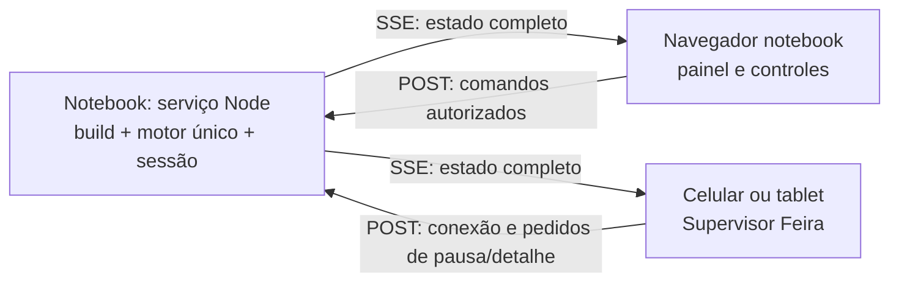
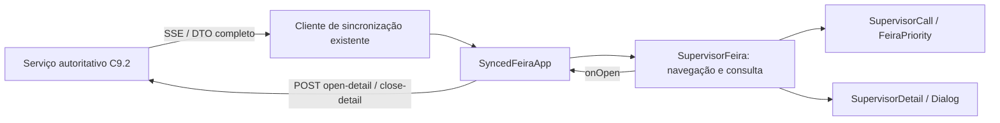
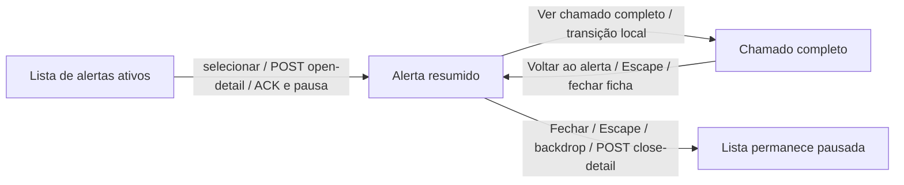

# Pontos de integração futura — observados e propostos

A ponte contextual ao Supervisor legado permanece pendente. A sincronização do Supervisor Feira está implementada localmente na C9.1 e adaptada à C9.2. As seções iniciais registram a análise original; evolução vigente na seção final.

## Fronteiras atuais

- Na análise original App.jsx montava somente SceneController. Até C9, App já seleciona apresentação padrão, plataforma e Feira acima dele, sem concorrência de hash/teclado.
- Posições 3–10 são adaptadores de tutorial, não estado conectado ao BackOffice.
- src/views/supervisor/index.jsx expõe SupervisorView completo, mas ele não integra as dez posições configuradas.
- DetalheDoTutorial passa dados por props para ChamadoDetalheView; restante usa lookup de fixture.
- QuadroSupervisor reutiliza CSS/header do Supervisor e barra tutorial. Essas dependências não podem ser refatoradas incidentalmente.
- ID compartilhado entre fixtures não prova que um registro histórico seja a mesma ocorrência.

## Ponte mínima proposta para US19

BackOffice mantém fonte/filtros/tela em estado próprio. Botão “Ver demonstração do Supervisor” abre aviso de fonte roteirizada independente e timers próprios. Escolha inicial (tutorial ou Supervisor completo) precisa de aceite. Não mapear ID do histórico ao mock silenciosamente.

Pausar relógio da Feira ao sair; cancelar não perde estado. Ao entrar, desmontar consumidores de teclado/hash incompatíveis; montar legado por adaptador externo. Voltar restaura filtros/seleção/rolagem conforme contrato aprovado, sem retomar Feira automaticamente. Não modificar Supervisor para executar essa ponte. Integrar fonte comum será outra etapa.

## Aceite/testes futuros

Ida/cancelar/volta, refresh e links; filtro preservado; aviso claro; nenhum anúncio de tempo real; pausa/reinício; ausência de timers residuais; comportamento original do Supervisor. UI nova em 1366×768 e foco do retorno validado. Nenhuma escrita em cadastro/estoque ou comunicação externa.

## C9.1 — planejamento da sincronização Notebook ↔ Supervisor Feira

15/10/2026. Planejamento aprovado e **implementação local autorizada/concluída**; [resultado C9.1 e roteiro físico](../produto/entrega-c91-sincronizacao.md). Os contratos abaixo registram a proposta aprovada; inventário efetivo, testes e limites no relatório. Sem commit/merge/push/deploy. Este é o contrato técnico central desta evolução; tarefas/fases e estado ficam no backlog/plano/continuidade. O identificador C9.1 desta solicitação significa sincronização entre dispositivos, diferente do subincremento “C9.1 — motor” da entrega C9 anterior. C9 permanece local e sem homologação visual; a experiência completa passa a exigir homologação conjunta em dois dispositivos.

### 1. Diagnóstico e preservação

Branch verificada feature/modo-feira, HEAD 240253d357560c5674e99bfccd7816632b388f29, igual à referência local feature/next-evolucao. Sem staging. Implementação, testes, evidências e documentação C9 continuam modificados/não rastreados, preservados integralmente. Não criar branch, commit, merge, push ou deploy. A referência de 322 testes/build/importador é da execução C9 anterior, não foi reexecutada nesta etapa documental.

Código inspecionado: App.jsx, FeiraApp.jsx, temporalState.js, useFeiraClock.js, selectors.js e contratos C9. O motor createFeiraClock é puro em sua transição e aceita relógio/scheduler injetáveis; pode ser reutilizado no serviço Node. No standalone C9, useFeiraClock instancia um motor por montagem, pausa por blur/visibility/hash e encerra efeitos ao desmontar. Antes da C9.1 cada aba iniciava T0 sozinha. A C9.1 adiciona serviço/protocolo/sessão e recuperação no caminho conectado; standalone continua explícito e independente. Um link/QR para a URL atual não resolve a sincronização.

selectFeira/readSnapshot reutilizam getDataset e projectSnapshot/eventAt. As duas saídas futuras já têm tratamento; não reconstruir essas regras. O hook e os seletores precisam de uma fronteira de transporte para o modo conectado, sem alterar a consulta histórica ou introduzir segundo engine no cliente. Não usar localStorage, BroadcastChannel ou relógios iniciados simultaneamente como sincronização entre dispositivos.

Os servidores dev iniciados nas portas 5173/5175 usam 127.0.0.1: o endereço do celular aponta para o próprio celular, e esses binds não expõem o notebook à LAN. Somente binds temporários do serviço foram autorizados para implementação; não alterar permanentemente firewall/rede. O estado real desses processos deve ser confirmado antes de qualquer intervenção futura.

### 2. Arquitetura recomendada e topologia

**Um processo Node no notebook**, independente da aba, serve o build compilado sob /OrquestraNEXT/ e a API de sessão na mesma origem/porta. Esse processo detém o único createFeiraClock, os snapshots, revisões, autorização de controles e pausas. O notebook hospeda a autoridade; seu navegador é o painel de controle dessa autoridade. O mobile é uma projeção somente de leitura, com pedidos de interação autorizados. Nenhum cliente conectado monta useFeiraClock/createFeiraClock ou avança T0/T1/T2.



URLs propostas (não habilitadas): notebook `http://<IP-LAN>:5180/OrquestraNEXT/?modo=feira&sessao=<id>`; mobile `http://<IP-LAN>:5180/OrquestraNEXT/?modo=supervisor-feira&sessao=<id>`. Porta 5180 é hipótese a verificar, não reserva. Usar hostname/origem canônica mostrada pelo launcher, inclusive no notebook; não depender de localhost para compartilhamento de sessão/cookies. A sessão não é uma credencial. Pareamento e concessão de papéis são separados.

Rede preferencial: roteador portátil dedicado, notebook e celular no mesmo Wi-Fi, com comunicação entre clientes habilitada e sem dependência da WAN. Reserva DHCP recomendada; launcher exibe IP/porta, URLs e estado de conexão. QR pode ser recurso posterior; link/IP manual é contingência sem nova biblioteca. Hotspot do notebook é alternativa após ensaio com o hardware real. Hotspot do próprio celular/USB-tethering varia por SO e fabricante e não deve ser presumido funcional. Evitar Wi-Fi visitante com client isolation, captive portal ou bloqueio de LAN.

Após aprovação: inventariar interface/IP, ligar o serviço só no IP da LAN escolhido, porta estrita, liberar no firewall apenas o perfil/rede/interface/sub-rede necessária, sem desligar o firewall inteiro. Não abrir portas no roteador nem expor na internet. Arquivos do build, fontes, logo e runtime precisam estar locais antes de sair para o evento. Serviço compilado substitui Vite dev apenas na bancada, sem encerrar silenciosamente os servidores atuais. Comandos de instalação/configuração de SO dependem da máquina real e de autorização própria; não foram executados.

Após reinicialização do notebook: operador conecta à rede, inicia launcher, confirma IP, novo sessionId/serverInstanceId e pareamento. Recomendar **nova sessão em T0 pausado**, com Iniciar explícito após conferir os dois dispositivos; não recuperar prazo monotônico nem aceitar comando pendente da sessão anterior. Persistência de sessão/serviço de inicialização automática fica fora do primeiro corte. Essa política conectada difere do autostart standalone C9 e exige aprovação.

### 3. Transporte: SSE + POST, WebSocket e serviço remoto

| Alternativa | Vantagens | Limites/dependências | Recomendação |
| --- | --- | --- | --- |
| SSE/EventSource + HTTP POST, mesma origem | Push de estados; reconexão nativa do stream; comandos com ACK HTTP; implementável com node:http já disponível, sem novas dependências | SSE sozinho é unidirecional; POST completa o canal inverso. Precisa heartbeat, autenticação, timeout/recuperação e controle de backpressure. Limite de conexões HTTP/1 por navegador/origem recomenda uma conexão por aba | Preferida para dois dispositivos e payload pequeno |
| WebSocket | Canal único full-duplex; adequado a controle mais intenso | Node possui cliente WebSocket nativo, mas isso não oferece um servidor WebSocket pronto. Exigiria aprovar dependência explícita de servidor, como ws, e rever package/lock; não usar dependência transitiva do Vite como contrato. Heartbeat/reconexão/resync continuam necessários | Alternativa se houver preferência explícita por WebSocket; não implementar protocolo de frames manualmente |
| Serviço remoto HTTPS + SSE/WSS | Dispensa IP local entre clientes e pode atravessar redes diferentes | Precisa backend persistente, TLS/DNS/autenticação, internet de ambos, hospedagem e monitoramento; latência/indisponibilidade, limites de conexões/egress e possível custo recorrente. GitHub Pages não hospeda esse backend | Contingência opcional, não base offline; fornecedor/plano/preço não selecionados |

SSE+POST é um mecanismo equivalente de comunicação bidirecional da aplicação, não SSE full-duplex. Recomendação técnica desta proposta, ainda sujeita ao aceite do usuário. Não instalar infraestrutura ou pacote agora. Node observado v24.16.0; confirmar runtime da máquina do evento na implementação, sem atualização silenciosa.

Não combinar página HTTPS do Pages com HTTP/WS inseguro da LAN. Bloqueios de mixed content, permissões de acesso local e comportamento por navegador tornam essa composição inadequada como solução garantida. Na topologia recomendada as duas telas vêm do **mesmo serviço local HTTP**. HTTP local não cifra dados/tokens e só deve ser aprovado para rede dedicada confiável com massa sintética. Se for exigida confidencialidade contra participantes da LAN, adotar HTTPS local confiável nos dois dispositivos (certificados/CA e gestão de confiança com escopo próprio), ou backend remoto HTTPS; não orientar a desativar proteções do navegador.

### 4. Fonte única de verdade e payload

O servidor carrega somente as fontes aprovadas para o domínio conectado: T0 08:00/10, T1 08:30/16, T2 09:30/24, e mantém a fase de encerramento em T2. Durações 45/45/45/10 segundos e 1×/2× reutilizam o contrato C9. Cada transição substitui a carteira completa; registros/deltas nunca se somam. O servidor projeta os marcos na referência da fonte; CH-006/Saída futura em T1 e CH-017/Saída futura em T2 continuam ocultos. TA/TB/ETA/SLA/cor não são recalculados.

Ambos recebem o **mesmo DTO projetado** com records, summary, distribuição, deltas e explicações/fontes; apresentações diferentes não refazem fatos no relógio do cliente. O mobile não importa dados futuros nem fixtures do Supervisor para completar respostas. Na adaptação, separar a parte pura dos seletores da carga local para que o bundle conectado não precise montar/importar o motor/datasets; standalone C9 mantém seu caminho explícito. Receber referência futura ou versão incompatível gera erro/estado indisponível, nunca fallback silencioso para um motor local.

Transmissão completa na conexão e em toda alteração relevante de fonte/controle; checkpoint de restante e heartbeat a cada ~1 s como hipótese inicial. Snapshot completa tem no máximo 24 registros; medir tamanho/latência antes de otimizar. Para clientes lentos, descartar estados superseded ainda não enviados e entregar o atual completo; limitar fila e fechar/resincronizar se necessário. O histórico de eventos não é fonte de reconstrução obrigatória.

### 5. Contrato de mensagens proposto, versão 1

Envelope de estado, com valores reais de T0 ilustrativos; arrays/objetos abaixo são tipos, não JSON executável:

```text
STATE {
 protocolVersion: 1,
 appVersion: buildId, datasetVersion: sourceSha256,
 sessionId: UUID, serverInstanceId: UUID,
 revision: inteiro crescente nesta sessão,
 cycle: inteiro, phase: T0 | T1 | T2 | END,
 snapshot: {source, reference, recordCount},
 playback: {
   status: running | paused, speed: 1 | 2,
   remainingSimulatedMs, remainingWallMs,
   pauseReasons: [{reason, ownerClientId?, interactionId?}]
 },
 records: registros completos projetados da fonte atual,
 summary, distribution, changes, delta, provenance,
 controller: {clientId, leaseValid},
 interactionLocks: [{interactionId, clientId, callId, expiresInMs}],
 sentAt: timestamp diagnóstico do servidor
}
```

remainingSimulatedMs mede orçamento de exposição nominal, não duração entre horários operacionais; remainingWallMs = remainingSimulatedMs/speed. Fase END continua snapshot T2. sentAt não governa o relógio do celular. revision aumenta também em checkpoints de restante; qualquer mudança de fatos/pausa/comando é sequenciada pelo serviço. Não há comparação de revisions entre sessões diferentes. Informações de permissão sensíveis não são distribuídas como tokens no STATE.

Mensagens cliente/servidor:

| Mensagem / endpoint conceitual | Conteúdo e semântica |
| --- | --- |
| PAIR / POST api/pair | Código temporário verificado pelo serviço; concede papel mobile por padrão. Papel controller apenas por credencial de bootstrap exibida no terminal local, digitada pelo operador e trocada por sessão; nunca conceder papel confiando em campo enviado pelo cliente. Sessão opaca em cookie HttpOnly/SameSite=Strict |
| HELLO / POST api/connect | protocolVersion, appVersion/datasetVersion conhecidos, clientId e sessão/revision conhecidos; valida autorização, emite estado completo atual |
| STATE / GET api/events (SSE) | id = sessionId:revision. A primeira mensagem sempre contém o estado completo, inclusive reconexão com Last-Event-ID. Não presumir replay de todos os eventos |
| GET api/state | Resposta completa no mesmo contrato, sem cache, para recuperação; clientes rejeitam resposta HTTP atrasada que chegar depois de revisão SSE mais recente |
| COMMAND / POST api/commands | commandId UUID, sessionId, baseRevision, ação permitida, argumentos validados; autenticação/papel e bloqueios são conferidos no serviço |
| ACK | commandId, accepted/rejected, appliedRevision, reason e STATE atual. ACK perdido não permite executar o comando duas vezes |
| INTERACTION_OPEN/CLOSE/HEARTBEAT | interactionId, ID_Chamado, revisão vista; pedido/renovação/liberação de bloqueio de detalhe, conforme política A recomendada |
| HEARTBEAT / stream + POST lease | Sinal de vida do serviço/cliente/controlador; não é outro relógio operacional |
| ERROR / SESSION_CHANGED | Versão inválida, sessão substituída, autorização expirada ou fonte inválida: parar comandos, solicitar pareamento/resync explícito |

Servidor serializa comandos. Guarda commandId → resultado em cache limitado por sessão (hipótese 10 min/1000 comandos; documentar política final). Mesmo commandId devolve o mesmo resultado sem nova ação. O serviço mantém uma janela limitada de metadados das revisões para conferir precondições; revisão fora da janela é rejeitada com resync. baseRevision anterior a checkpoint que só mudou restante pode ser aceita se fase/ciclo/velocidade/locks/status não mudaram; se qualquer um mudou, rejeitar conflito e devolver estado atual, exigindo nova intenção. Pausa/restart não ignoram essa validação silenciosamente. ID, papel e revisão são validados também para pedidos de detalhe. Não reexecutar automaticamente controles que estavam pendentes durante desconexão.

Cliente aplica STATE atomicamente (fonte, fatos, métricas e reprodução juntos); descarta sessão inválida, revisão menor/igual e duplicatas. Mudança de serverInstanceId/sessionId exige handshake e limpeza de seleção/locks/deltas. App/dataset incompatíveis mostram orientação de recarregar a mesma origem; não compor fatos de builds diferentes. Hash do conteúdo projetado pode ser acrescentado para verificação, mas não é autenticação.

### 6. Controles e interação: alternativas que exigem aprovação

| Política mobile | Vantagens | Riscos |
| --- | --- | --- |
| A — Abrir detalhe pausa globalmente | Preserva a leitura estável já aprovada na C9; ambas as telas seguem a mesma referência | Visitante pode interromper o ciclo; requer bloqueios por interação e informação clara ao operador |
| B — Congela somente detalhe | Painel principal continua autônomo | Detalhe fica em revisão anterior; deve dizer “congelado em Tn/revisão X; operação continua”. Diverge da pausa de detalhe atual e pode confundir fatos simultâneos |
| C — Solicitação de pausa ao notebook | Operador decide quando interromper; bom para mais visitantes | Pedido pode aguardar/ser recusado; não abrir detalhe como atual antes da decisão. UX mais complexa |

**Política A aprovada e implementada**, por consistência com a C9. O notebook é o único que pode iniciar/retomar/reiniciar/alterar velocidade. O mobile só envia pedido de pausa por detalhe/explicação ou botão de solicitar pausa; não transmite alterações de chamados, despacho ou estoque.

Fluxo recomendado: toque no chamado envia INTERACTION_OPEN; serviço valida ID no snapshot atual, adiciona lock e pausa globalmente em uma revisão; mobile abre o detalhe **após ACK com esse estado completo**. Se o pedido competir com uma transição, recebe o estado atual e solicita confirmação para abrir aquela referência, sem montar detalhe antigo como atual. Sem ACK: mostrar “aguardando conexão”, sem fingir pausa global. Fechar libera somente seu lock, mantendo pausa manual/análise; retomada sempre pelo notebook.

Locks renovados a cada ~5 s e expiração proposta de 15 s (recomendação para ensaio, não valor implementado). Celular bloqueado/perdido não paralisa a bancada indefinidamente: expirar lock **mantém a reprodução pausada**, passa a permitir retomada explícita do operador. Nunca retomar por timeout. Operador pode revogar lock/reiniciar com aviso; mobile encerra o detalhe revogado ao receber nova revisão. Se estiver desconectado, mantém detalhe claramente “último estado recebido; sem sincronização”, nunca atual, até obter novo STATE. Múltiplos detalhes não se desbloqueiam entre si; não enviar tokens de outros clientes.

### 7. Notebook em segundo plano e controlador exclusivo

Recomendação inicial: preservar a política C9 de pausar quando o painel controlador do notebook perde foco/visibilidade. Eventos viram comandos globais para o serviço; retorno da aba continua pausado. **O serviço continua sendo o único relógio**, inclusive na pausa; mover o engine para Node não implica alterar a política aprovada. Abas mobile em segundo plano não podem comandar retomada/avanço e não criam motor substituto.

Um controller lease exclusivo, com heartbeat ~2 s e vencimento ~6 s, impede controle concorrente por segunda aba. Perda/fechamento/crash do painel ou lease causa pausa global; reabrir não retoma automaticamente. Demais abas ficam leitoras até transferência explícita do controle. Os prazos são hipóteses a testar em celular/notebook reais. O operador deverá aceitar que alternar para outro aplicativo pausa globalmente. Se for desejado continuar com painel em segundo plano, isso é **mudança explícita do contrato C9**, para aprovação separada; não inferir da existência do servidor Node.

Servidor após suspensão/atraso extremo do event loop deve pausar por interrupção antes de consumir um grande salto monotônico, sem atravessar vários snapshots inesperadamente ao acordar. Retomada explícita a partir do último estado/tempo restante confirmado; reinicialização do processo usa nova sessão T0 pausada. Ensaio de suspensão/retorno obrigatório.

### 8. Reconexão e significado de “sincronizado”

Hipótese de serviço: checkpoint/heartbeat 1 s; cliente marca conexão degradada após 3 s sem mensagem. EventSource reconecta; controlar backoff 1/2/4/8 s, teto 10 s e jitter, sem acumular instâncias ou reconectar duas vezes em paralelo. Ao desconectar, congelar último estado/contador confirmado e sinalizar offline, desabilitar controles de sessão. Nenhum avanço local de fase, nem extrapolação de fatos. Não prometer relógio de segundos exato no mobile: mostrar restante enviado pelo servidor e idade local da recepção, sem usar horário absoluto do celular para decisões.

Entrada tardia/refresh recebe o estado atual completo, sem reiniciar servidor ou perder pausa. Após reconexão, nova revisão substitui atomicamente estado e seleção incompatível; não reconstruir pela soma de eventos perdidos. Tela bloqueada pode suspender JavaScript/conexões no SO: ao retornar, requer STATE fresco antes de mostrar “sincronizado”. Sessão substituída requer confirmação/pareamento e nunca reutiliza ACK/comandos de outro processo.

Latência significa que não se garante igualdade física instantânea das telas. Meta proposta na rede dedicada: convergir à mesma sessão/fonte/revisão em até 1 s de operação normal e até 3 s após conexão restabelecida, a validar no hardware. Nunca apresentar um estado reconhecidamente antigo como atual: status visível sincronizando/sincronizado/sem conexão, revisão e referência. Requisitos de latência e limiares sujeitos ao aceite. ACK de todos os leitores não bloqueia toda transição; a política de pausa é comandada por interações/controle, sem protocolo de consenso distribuído.

### 9. Supervisor Feira mobile específico

Novo modo supervisor-feira acima do SceneController. Header: ORQUESTRA, “Supervisor Feira — Simulação”, Tn/hora/revisão/conexão e reprodução global. Cards compactos de ativos/atenção; lista por prioridade materializada, Laranja/Vermelho destacados por texto e cor. Item: ID/unidade/status/criticidade, técnico/supervisor quando informados, categoria/componente e motivo. Detalhe: marcos projetados, TA/TB/SLA informados, recorrência, motivo/insight, fonte e indicação de pausa/lock. Concluídos em área histórica, sem alerta ativo. Mudanças por ID chegam do mesmo estado/delta; não são inferidas pelo relógio local.

Reutilizar Dialog/badges/explicabilidade e camada de dados/seletores puros, com layout CSS próprio 390×844 e tablet. Sem editar SupervisorView, cenas 1–10, fixtures, animações ou timers originais. Sem botão de despacho, edição de base, estoque ou recomendação de ML comprovado. Reuso visual não autoriza montar o Supervisor original com outra fonte. A ponte de ida/volta do legado US19 permanece independente.

### 10. Segurança proporcional da rede local

Código de pareamento temporário, limitação de tentativas e expiração; sessão/papel validados no servidor. Credencial controller entregue só ao operador local e não em QR público/URL/log. Mobile recebe papel limitado. Cookies HttpOnly/SameSite estritos e token CSRF para POST; Origin/Host contra allowlist do endereço configurado, sem CORS *, sem confiar somente em “rede local”. Reconexão EventSource usa cookie same-origin; não colocar segredo em query string. Se WebSocket for escolhido, validar Origin e a sessão no handshake, sem supor proteção CORS automática.

Servidor expõe só build/rotas/API aprovadas; impedir path traversal/symlink para repositório/XLSX/.git/.env, limitar corpo/frequência/número de conexões/tamanho de mensagem, validar schema e papel, idempotência e revisão. CSP compatível e scripts/estilos locais; sem endpoints de shell, upload, edição ou execução de comandos. Logs técnicos sem cookies/tokens/dados desnecessários. HTTP continua vulnerável a captura na própria LAN; autenticação limita comandos indevidos, não substitui criptografia. Não anunciar segurança corporativa da demo.

### 11. Arquivos previstos e dependências

| Arquivos propostos | Responsabilidade |
| --- | --- |
| server/feira-server.mjs, server/feira-session.mjs | Servir build/API, autoridade temporal, papéis/lease/locks/revisões e projeção |
| src/feira/sync/protocol.js, transport.js, useSyncedFeira.js | Contrato/validação, stream+POST, resync e estado externo recebido; sem engine cliente |
| src/feira/SyncedFeiraApp.jsx | Adaptar painel notebook aos DTOs e comandos, separando apresentação sem duplicar regras |
| src/feira/SupervisorFeira.jsx e .module.css | Experiência mobile conectada específica |
| src/feira/FeiraApp.jsx, selectors.js, useFeiraClock.js, temporalState.js | Extrair reuso puro/presentacional necessário; manter standalone e connected mutuamente exclusivos, sem quebra da C9 |
| src/App.jsx | Entrada supervisor-feira e seleção explícita da sessão conectada |
| package.json | Futuro script local de serviço; nenhuma dependência nova com SSE. package-lock somente se alteração realmente necessária/aprovada |
| tests/feira-sync-service.test.mjs, feira-sync-browser.test.mjs | Protocolo/motor único/reconexão/segurança e duas telas |
| docs de modos, integração, backlog, plano e continuidade | Contrato e resultados; futuro roteiro de bancada após ensaio |

Nomes desta tabela são do plano; nomes e alterações efetivos no relatório C9.1. ConsultationUI.jsx importa o serviço histórico: não presumir que todo componente visual existente seja livre de fonte. Se o bundle conectado carregar dados por essa cadeia, extrair apenas os primitivos visuais necessários para módulo puro, mantendo reexports/defaults e regressão dos consumidores atuais; não refatorar o Supervisor. Essa extração eventual precisa ser medida no build da implementação. Servidor não deve importar React/CSS ou abrir fixtures do Supervisor. Node/http/fs/crypto e APIs nativas do navegador bastam para SSE+POST; isso é avaliação de viabilidade, não PoC validada. Se WS for escolhido, autorização de dependência/lock será necessária. Não modificar dados ou infraestrutura agora.

### 12. Testes, aceite e sequência

| Grupo | Casos e evidência exigida após autorização |
| --- | --- |
| Autoridade/protocolo | Uma sessão/motor e um controller; revisões monotônicas, checkpoints, comandos duplicados/fora de ordem/ACK perdido, conflito, versão incompatível, schema inválido, payload só projetado e comparação por ID |
| Duas telas | T0/T1/T2 10/16/24 iguais; 0/1/4 alertas ativos; pausa/retoma/reinício/1×/2×/loop e contador; estados completos de entrada tardia/refresh; nenhum reset causado por leitor |
| Interação | Política aprovada A/B/C, lock antes de detalhe, dois detalhes concorrentes, fechar sem retomar, expiração/revogação e perda de Wi-Fi com detalhe aberto |
| Resiliência | Wi-Fi desconecta/retorna, SSE lento/duplicado/atrasado, resposta HTTP invertida, notebook oculto/desfocado/fechado, controller lease, celular bloqueado, SO suspenso, reinício servidor com sessão nova e nenhum replay de comandos |
| Segurança | Pareamento/roles/CSRF/Origin/Host, cliente sem autorização, limites, traversal e nenhuma exposição de repo/segredos; confirmar que leitor não despacha nem altera dados |
| Bancada real | Notebook e celular/tablet físicos no Wi-Fi dedicado com WAN desligada; acesso inicial/refresh/assets/API locais; firewall/client isolation e hotspot reais; medir convergência e retorno, não só emulação Playwright |
| Regressão | 322 anteriores +casos C9.1, ESM/build/base/rotas; standalone C9 preservada; Plataforma/Supervisor/dez cenas, fontes/planilha intactos |
| Duração/UX | 1366×768 e 390×844/tablet; ensaio mínimo proposto de 30 min reais com transições e falhas induzidas, seguido de ensaio de bancada prolongado antes do NEXT; sem timers/listeners/fila crescentes |

Aceite da experiência completa depende de teste real em dois dispositivos, sem internet pública, com fatos iguais por sessão/revisão/ID e política de pausas homologada. Browser contexts no mesmo PC não substituem o aceite físico. Meta de convergência e comportamento em desconexão explícitos; nunca assumir sincronização offline entre dispositivos desconectados. C9 visual ainda pendente; 322 testes prévios não aprovam transporte/mobile.

Sequência proposta: (1) aprovar arquitetura/transporte/políticas e preservar C9 local; (2) sessão/protocolo/motor único e testes puros; (3) servidor same-origin/pareamento/controles; (4) adaptar notebook sem motor duplicado; (5) mobile específico e detalhes; (6) reconexão/segurança/falhas; (7) regressão e bancada com WAN desligada; (8) homologação conjunta. Complexidade alta pela mudança de autoridade e recuperação, não apenas layout. Nenhuma execução de fase implica autorização de commit/publicação/integração.

Contingência NEXT: primeiro trocar a rede problemática por roteador dedicado/hotspot previamente ensaiado; se serviço falhar, reiniciar explicitamente em nova sessão T0 e reemparelhar. Se não houver sincronização, mostrar C9 standalone num único dispositivo e apresentação original como alternativa, indicando “demonstração sem sincronização”; isso **não satisfaz a homologação completa**. Não simular celular sincronizado com segundo relógio. Backend remoto só se previamente implementado/aprovado e com internet disponível, não improvisado na bancada.

### 13. Decisões aprovadas na autorização de implementação

1. Serviço local compilado no notebook, mesma origem, SSE+POST preferencial (ou WS com dependência explicitamente autorizada).
2. Política A recomendada para detalhes, controles exclusivos do notebook, locks e retomada explícita; avaliação dos prazos propostos.
3. Pausa global ao ocultar/desfocar/perder o controller; alternativa de continuar em background altera C9 e precisa de aceite expresso.
4. Sessão nova em T0 pausada após reinício do serviço, pareamento e Iniciar explícito no modo conectado; standalone mantém autostart atual.
5. Rede dedicada HTTP com limitações reconhecidas, ou escopo TLS; equipamento/OS reais e responsabilidades de rede/firewall; porta/IP só após verificação autorizada.
6. Metas de convergência, matriz física, ensaio real e sequência de implementação. Implementação/testes autorizados e concluídos no software; homologação física pendente. Sem instalação, commit, merge, push ou deploy.

Referências primárias consultadas para a proposta: [Node: cliente WebSocket nativo e distinção do servidor](https://nodejs.org/en/learn/getting-started/websocket), [Node HTTP](https://nodejs.org/docs/latest-v24.x/api/http.html), [MDN: SSE/reconexão/formato](https://developer.mozilla.org/en-US/docs/Web/API/Server-sent_events/Using_server-sent_events), [MDN: WebSocket e mixed content](https://developer.mozilla.org/en-US/docs/Web/API/WebSockets_API/Writing_WebSocket_client_applications). Não selecionado serviço comercial, portanto sem cotação ou gratuidade presumida.

## C9.2 — extensão aprovada do contrato

A sequência conectada vigente é T00–T11 do XLSX estendido, 27 s por estado +12 s finais, 336 s em 1×/168 s em 2×. Substitui a sequência de três posições no uso normal; fontes originais permanecem separadas. DTO inclui snapshotId/snapshotCount, fase, referência operacional, configuração de durações, finalWait, progresso, dados/indicadores ativos e auditEvents do estado. Sessão/revisão/versões e autorização da C9.1 preservadas; clientes não carregam datasets/motor. Nenhum novo transporte.

A dimensão T11 evidenciou rajadas de DTOs de aproximadamente 237 KB ao abrir detalhe: a fila SSE anterior era excedida e o ACK era invalidado pela reconexão. Correção: comandos publicam atomicamente uma revisão completa; ao haver backpressure, o stream mantém apenas uma referência pendente ao estado mais recente e envia após drain, sem enfileirar fotografias antigas. O ACK/HTTP não confirma conectividade SSE; revisões antigas continuam descartadas, sem replay de comandos desconectados. Falha ao abrir detalhe agora tem mensagem visível.

Política de pausa, locks, controle exclusivo, lease, heartbeat, pareamento, reinício de sessão e desconexão permanece aprovada. Fechar não retoma. T00 pausado em nova sessão; standalone explícito independente. [Resultados, limites e roteiro físico](../produto/entrega-c92-feira-estendida.md). Homologação em dois dispositivos com WAN desligada pendente; sem commit/merge/push/deploy.

## Identificação inequívoca da fonte — diagnóstico C9.2

Notebook em dev5173/5175 sem flag/session monta FeiraApp/useFeiraClock independente; Supervisor Feira sempre usa SyncedFeiraApp. Essa combinação pode apresentar T02 no notebook e T00 no serviço/mobile sem defeito no SSE. Para homologação conjunta, ambos devem abrir a origem do serviço (mesmo IP e porta5180), parear na mesma sessão, e o notebook deve assumir controle e iniciar. Revisão pode subir durante pausa por checkpoints de conectividade, sem avanço operacional.

Sintoma físico investigado: sessão1e450867/revisão1355 no celular, notebook informado em127.0.0.1:5175. Node lido emT00/paused/started=false, sem controlador; SSE200/text-event-stream com revisões1381/1382. Mistura inicial de fontes confirmada. Na conferência simultânea posterior, o usuário confirmou ambas T00/08:00, mesma sessão/revisão2158, e notebook somente de leitura. O segundo impedimento era pareamento do notebook como Supervisor, sem iniciar o motor. Nenhuma falha SSE demonstrada. Interfaces agora distinguem modo independente e fonte/sessão/revisão/reprodução no conectado; motor/transporte/protocolo não alterados. [Evidências, limites e roteiro atualizado](../produto/entrega-c92-feira-estendida.md#diagnóstico-da-divergência-na-homologação-física--15102026). Coleta inicial preservou a sessão; após validação e aviso houve reinício controlado no build atualizado. Novo pareamento ADMIN no notebook, Supervisor no celular, controles e avanço conjunto confirmados pelo usuário; serviço posteriormente lido emT01. Homologação do ciclo físico completo continua pendente.

A UI permite trocar o acesso de leitor para operador pelo pair(code) já aprovado; não altera permissões do leitor nem autentica com código inválido. Sem logout destrutivo/remoção de cookies manual ou bypass. Confundir revisão de conectividade com avanço de snapshot, ou usar código Supervisor no notebook, deve ser explicado explicitamente. Código ADMIN fica privado com o operador; códigos não são publicados no chat/URLs/evidências. Handoff temporário nesta investigação usou arquivo fora do repositório0700/0600, com expiração/remoção, sem exposição HTTP. Protocolo/serviço/motor originais não foram alterados nesta correção de UX.

## Supervisor Feira — adaptação visual autorizada (19/10/2026)

Escopo US14.13, com preservação US01 e governança US16. Referência original inspecionada antes da adaptação; apresentação e seus consumidores permanecem intactos. O serviço C9.2, DTO, ordenação, SSE e POST não mudam.

| Elemento | Referência original | Implementação anterior Feira | Decisão | Justificativa |
| --- | --- | --- | --- | --- |
| Cabeçalho/tipografia | SupervisorHeader / SupervisorView.module.css | Header inline, Arial | Adaptar em CSS/JSX isolados | Marca/navy, fonte de sistema offline, fotografia e reprodução explícitas |
| Cards/hierarquia | ChamadoCard / ListaChamados | Botões com textos em sequência | Adaptar SupervisorCall | Mesmo padrão de faixa/badge/local/problema; sem SLA fictício |
| Criticidade | PriorityBadge, normal/media/alta/critica | CriticalityBadge, quatro cores BASE | Manter contrato, adaptar apresentação | Verde/Amarelo/Laranja/Vermelho não são conversão automática de prioridades antigas |
| Detalhes | ChamadoDetalheView / DetalheDoTutorial | FeiraDetail compartilhado | Adaptar SupervisorDetail específico | Agrupar evento/técnica/tempos/histórico/orientação e explicitar EXT; não afetar BackOffice |
| Alertas | AvisoCritico, roteiro com conteúdo fixo | Contagem/cores na lista | Aba Alertas e destaque não modal | Só ativos Laranja/Vermelho da fotografia; detalhe voluntário exige ACK |
| Navegação | BottomNav / BarraInferior tutorial | Seletor Ativos/Concluídos | Adaptar Chamados/Alertas/Mais | Três conteúdos funcionais, sem mapa ou botões fictícios |
| Microinterações | useFlip / CardTransicao / useRoteiro | Sem transição visual de posição | Técnica FLIP isolada | Reage a fotografia/ciclo, nunca a timers ou revisões de heartbeat |
| Responsividade | Shell máximo448px / rolagem interna | Grid até1000px | Layout mobile/tablet até900px | Rolagem do documento, navegação sticky sem cobrir conteúdo |

### Responsabilidades e decisão de isolamento

**Contexto:** dependências originais incluem fixtures, temporizadores e regras de SLA próprias. **Opções:** importar os componentes completos; modificar compartilhados; adaptar apresentação isoladamente. **Decisão vigente (autorização do usuário de19/10):** adaptar em `src/feira/supervisor/`, reutilizar logo e os primitivos puros Dialog/StatusBadge existentes. Nenhum import de src/views, dados do tutorial, useRoteiro, useFeiraClock ou motor no mobile. Consequência: pequenos componentes específicos para o contrato materializado; proteção do legado e do BackOffice. Não requer ADR separado.



Abrir: card → onOpen → POST open-detail → ACK com row/metadados confirmados → detalhe. Pending bloqueia duplicação, falha mostra aviso sem detalhe. Fechar envia close-detail e mantém pausa; retomada somente pelo notebook autorizado. Reconexão/versões/locks continuam nos módulos existentes. Header externo preserva sessão/revisão/conexão; interno apresenta snapshot/hora/reprodução. Desconexão congela a fonte, desabilita abertura e sinaliza detalhe já aberto.

### Contrato dos campos de interface

Todos disponíveis conforme fotografia atual recebida, não por consulta de estados futuros. Valores nulos/vazios: “Não informado”; zero preservado.

| Campo/indicador | Origem e significado | Transformação/regra | Tipo | Consumidor |
| --- | --- | --- | --- | --- |
| Snapshot/hora | view.snapshotId / metadata.reference | Hora HH:mm da referência, sem avanço independente | BASE | Header |
| Sessão/revisão/conexão | sessionId/revision, estado do transporte | Diagnóstico externo existente | BASE / estado técnico | SyncedFeiraApp |
| Ativos/Atenção/Total | view.summary | Contagens do seletor existente; atenção exclui concluídos | CALC | Indicadores |
| Identidade/local/equipamento/problema | ID_Chamado, Cliente, Unidade, Tipo de Unidade, Problema | Textos fornecidos; não equivalem a cadastro mestre | BASE | SupervisorCall / Detail |
| Cor/status/motivo | Criticidade_ORQUESTRA, Status, Motivo_Criticidade | Badge pela cor; alertas somente Laranja/Vermelho ativos; ordem de view.ordered preservada | BASE | Call / Alertas / Detail |
| Abertura e histórico | Criado em, Contactado, Aceito, Chegou ao Edifício, Saída; row.events | Evento future oculto, sem calcular duração local | BASE | Call / Detail |
| Fechamento | Texto de solução registrado, não um horário de encerramento técnico | Exibir texto disponível ou Não informado; não converter em evento temporal | BASE | Detail |
| TA/TB/SLA_min/ETA_min/Percentual_SLA | Valores materializados da fotografia | Minutos/fração; definições sintéticas preservadas; ETA técnico sem previsão atual pós-chegada | BASE | Detail |
| Técnico/Supervisor/componente | Campos homônimos / Componente Principal / Subcomponente | Vínculo registrado, não disponibilidade ou localização atual | BASE | Call / Detail |
| Mudanças | view.changes por ID entre fotografias; FEIRA_EVENTOS auditado no serviço | Novo/cor/status/concluído; destaque e FLIP só em mudança de fotografia/ciclo | CALC sobre BASE | Call / Mais / motion |
| Orientação/recorrência | Insight_ORQUESTRA / Recorrencia_30d | Texto sintético e valor fornecido, sem causalidade/ML ou soma de eventos | BASE | Detail |
| Estoque/logística/pessoal reais | Fontes externas ausentes | Sem valores ou ações fictícias | EXT | Detail / Mais |

Navegação guarda o filtro de chamados; Alertas não inclui concluídos. Mudanças de snapshot atualizam cards com IDs estáveis; heartbeat não repete animações. O cleanup cancela todas as animações criadas pelo efeito antes da próxima medição FLIP e ao desmontar; impede acumulação e realimentação de coordenadas animadas em transições rápidas. prefers-reduced-motion desativa FLIP/fade. Não há pop-ups automáticos, telefonar, despachar, reservar ou comprar. UI usa fonte de sistema e assets locais; nenhum @import de Google Fonts. Evidências, resultados e pendências no relatório C9.2, seção da evolução visual.


### Alertas operacionais — revisão autorizada em 19/10/2026

US14.13, sem alteração de protocolo, ordenação, cores BASE ou fontes. A aba Chamados mantém SupervisorCall; a aba Alertas usa SupervisorAlert, uma variante de resumo em SupervisorParts que reutiliza FeiraPriority, StatusBadge, onOpen e SupervisorDetail/Dialog. A separação evita retirar informações da lista de chamados ou duplicar o fluxo de confirmação. O detalhe conserva histórico, TA/TB, componentes, contratos, insight completo e limites EXT.

**SLA BASE e CALC:** FEIRA_REGRAS/“SLA E PERCENTUAL” define ativos como tempo desde criação/SLA_min. Percentual_SLA é fração consumida, não disponível:0,8=80%;1=100%. Exibir consumo somente com fração numérica finita>=0 e SLA_min numérico finito>0; zero de consumo é válido. Barra limitada visualmente a100, com número real e nome acessível, inclusive acima de100. Ausência/invalidez: “SLA não calculável nesta simulação”.

A autorização desta revisão permite uma exceção de apresentação ao contrato anterior que não exibia restante: **CALC sintético no snapshot**, nunca previsão de prazo real. Definir decorrido=(metadata.reference−Criado em)/60000; verificar ativo, datas válidas, decorrido>=0 e abs(decorrido/SLA_min−Percentual_SLA)<=0,000051 (arredondamento da fração a4 casas). Somente nessa condição, restante=max(0,SLA_min−decorrido), equivalente a SLA_min×(1−fração não arredondada). Rotular “≈ … min restantes no snapshot”; caso zero, “Prazo consumido no snapshot”. Inconsistência/sem referência: consumo materializado pode continuar visível, mas “Tempo restante não calculável nesta simulação”. Não reconstituir pausas, usar TA/TB, relógio real, timestamps futuros ou ETA como prazo. Nada é persistido no DTO ou recalculado no motor. A regra não é transportada à Plataforma/histórico. Detalhes mantêm valores BASE originais.

**Natureza e urgência:** passageiro preso explicitamente registrado destaca impacto; motivo com SLA/tempo acumulado permite natureza de risco/excesso conforme fração válida; motivo com recorrência permite natureza de recorrência; demais casos mostram prioridade operacional e cor fornecida. A cor não é recalculada e não prova causa SLA. A explicação usa fatos observáveis do snapshot; não apresenta uma mudança de cor como causalidade automática. Mudança de cor exibe origem/destino uma vez no card com ID estável; heartbeat não repete notificações/animações.

**Evidência de impedimento:** Confirmado reconhece somente frase declarativa em Descrição do Problema no formato “(Atendimento) aguardando peça/componente por/— indisponibilidade registrada”. Prefixos de hipótese, negações e outras redações não são classificados como confirmação. Trata-se de reconhecimento conservador de registro textual, não NLP nem diagnóstico; textos não reconhecidos permanecem desconhecidos. Possível fator exige status Aberto/Contactado/Técnico a caminho, sem chegada registrada, ETA numérico finito maior que restante positivo e validado. ETA é do técnico. Não informado: “Impedimento não registrado.”, acompanhado de recomendação de confirmação. Componente/defeito/recorrência/EXT isolados não comprovam falta de peça. Nenhuma disponibilidade, localização, fornecedor ou logística é inventada.

**Recomendação CALC:** uma orientação principal, nunca ação executada. Impacto registrado → acompanhar atendimento crítico; espera/indisponibilidade explícita → verificar recurso registrado; ETA acima da janela → confirmar chegada; SLA consumido/excedido → priorizar análise; recorrência no motivo → comparar ocorrências; demais → confirmar impedimento com a equipe. Impacto com ETA conflitante preserva acompanhamento crítico e confirmação da chegada na mesma orientação. Não despachar, reservar nem modificar chamado.

Hierarquia: cor/ID/local/natureza → consumo e janela validada → razão curta → fator com nível de evidência → recomendação → botão único Ver detalhes do chamado. Layout compacto específico da aba Alertas; indicadores e navegação permanecem disponíveis em390×844. Sem modal automático ou pausa ao listar. Botão mantém POST/ACK antes de abrir; fechar permanece pausado; retomada exclusivamente pelo notebook. SSE, reconexão, entrada tardia, sessão/revisão/locks e descarte obsoleto permanecem existentes. Homologação de rapidez de decisão cabe ao usuário.


### Simplificação operacional e temas automáticos — 19/10/2026

Revisão posterior ao resumo450,autorizada pelo usuário na US14.13/US15. O modelo anterior ainda expunha rótulos e explicações repetidas. **Contrato atual do resumo:** cor e ID → problema em até2 linhas/local em1 linha → natureza/prioridade → prazo pertinente → impedimento em1 frase → uma recomendação → botão Ver detalhes do chamado. Removidos do alerta status repetido,parágrafo explicativo redundante da urgência,título interrogativo/nível de evidência permanente e mudanças detalhadas. Mudanças permanecem na lista Chamados e aba Mais; dados extensos continuam no detalhe completo. Mesmo caso realT03/CH-018:442px→371px em390×844,sem alterar os fatos. O resumo não cria uma segunda etapa/modal: selecionar Ver detalhes mantém o mesmo POST/ACK antes do detalhe completo e pausa global.

**Reutilização:** SupervisorParts contém SupervisorCall compacto,SupervisorAlert e CompactSla compartilhado. Call usa problema,local/status,natureza/SLA relevante e mudanças; técnico/supervisor e motivo completo estão no detalhe. CRITICALITY/FeiraPriority,StatusBadge e Dialog existentes preservados. Dialog recebe apenas estilos descendentes do escopo mobile; nenhum primitivo compartilhado foi alterado.

**SLA:** mantidos fração/unidades,validação de consistência e fórmula da revisão anterior. SLA principal somente quando Motivo_Criticidade menciona SLA/tempo acumulado e não há passageiro preso registrado. Passageiro preso destaca emergência e apresenta SLA válido apenas como texto secundário,sem barra principal; recorrência e outras prioridades também não promovem SLA a causa. Percentual inválido mostra “SLA indisponível nesta simulação”; resto desconhecido permanece explícito. Não usar TA/TB como restante,nem relógio do celular ou interpolação. Dados/regras geradoras/DTO nunca são modificados.

**Evidência e orientação:** classificação interna existente Confirmado/Possível fator/Não informado preservada. A UI apresenta “Aguardando peça — motivo registrado.” somente para a declaração positiva conservadora já aprovada; “Possível fator · Chegada do técnico pode comprometer o prazo.” somente com ETA do técnico maior que janela válida antes da chegada; demais “Impedimento não informado.” A recomendação principal mantém critérios anteriores e aparece sob Ação recomendada. Componente/recorrência não prova falta de peça,estoque/logística continuam EXT. Fontes/campos e explicações completas acessíveis no detalhe; nenhum despacho,reserva ou alteração automática.

**Tema:** CSS Modules em Supervisor.module.css,.theme atribuído por SyncedFeiraApp exclusivamente ao ramo mobile,incluindo acesso/pareamento,conexão/diagnóstico/erro,SupervisorFeira e Dialog nativo(top layer mantém herança DOM). Light é fallback; @media(prefers-color-scheme:dark) sobrescreve tokens e color-scheme nativo. A troca é puramente CSS: nenhum hook,listeners de tema,estado persistido,timer,remontagem,comando POST ou nova assinatura SSE. SyncedFeiraApp sofreu somente import/markup de escopo e atributo visual data-connection; protocolo/efeitos/comandos intactos. BackOffice/legado não recebem .theme e não herdam seus tokens.

| Token semântico | Light | Dark |
| --- | --- | --- |
| --page / --surface / --subtle | #f3f5f8 / #fff / #f7f9fc | #0c1420 / #142335 / #192b40 |
| --ink / --muted | #20364c / #526579 | #edf3fa / #b3c2d3 |
| --header / --header-ink | #e8eef5 / #17324d | #101d2c / #edf3fa |
| --line / --selected | #d4dee8 / #e6eff8 | #3b5067 / #253e58 |
| --link / --focus | #195787 / #286da0 | #b9dcff / #83c4ff |
| --green-bg / --green-ink / --green-edge | #e6f4eb / #156338 / #208449 | #173b2b / #9de6bb / #64cf94 |
| --yellow-bg / --yellow-ink / --yellow-edge | #fff5cc / #705400 / #967200 | #3b341a / #ffe399 / #e7c45d |
| --orange-bg / --orange-ink / --orange-edge | #fff0e1 / #984400 / #c05600 | #44301b / #ffd0a3 / #ffab62 |
| --red-bg / --red-ink / --red-edge | #ffe8e9 / #a71e2b / #c32939 | #48232c / #ffb7c0 / #ff8b99 |
| --warning-bg / --warning-ink / --warning-edge | #fff5e6 / #754300 / #c89947 | #372c1a / #ffdb9c / #937346 |
| --connection-bg / --connection-ink | #e2f3ed / #115e48 | #15362d / #b0edd3 |
| --overlay / --shadow | #061a3677 / #15324c12 | #000b / #0003 |

--brand=#112b45 preserva a marca clara local nos dois temas. Criticidades são campos BASE; a adaptação de tons/fundos não muda seu significado. Botões/select/input,foco,erros/offline,vazio,navegação,abas e detalhes usam os tokens. Fontes de sistema e assets locais; nenhuma CDN ou dependência instalada. Testes medem contraste de texto amostrado>=4,5:1 nos dois temas e identificam cores por texto/valor BASE; isso não constitui auditoria integral WCAG ou aceite de hardware físico.


### Alertas das cenas 3, 7 e 10 — contrato vigente

Diretriz do usuário19/10/2026 substitui orientações visuais conflitantes anteriores: preservar a identidade das cenas3(supervisor-cena-1-tela),7(supervisor-cena-4-aviso-alta) e10(supervisor-cena-7-aviso-estourado),adaptando somente o conteúdo/fluxo à operação Feira. Os arquivos originais não foram modificados. Referências são de apresentação roteirizada;seus IDs,tempos,recursos,ações fictícias e timers não são fonte operacional.

**Identidade adaptada:** cabeçalho navy,logo/Menu/Bell e navegação Radio/AlertTriangle/Ellipsis;cards12px/faixa de criticidade,respiro16px;modal16px com teto448px,cabeçalho suave Laranja/Vermelho,triângulo circular e CTA navy. Medição no render original:navy#090b29(derivado da regra oklch suportada),fundo#f9fafc,ink#19092e,borda#e1e5eb,Laranja#f9700e,Vermelho#db0003. A adaptação mantém cores funcionais BASE e ajustes tonais Dark/contraste;não renomeia BASE para prioridades do tutorial. A mesma pilha tipográfica Plus Jakarta Sans/ui-sans-serif/system-ui é declarada,com fallback local e sem importar CSS/Google Fonts do legado.

**Reutilização segura:** somente os SVGs puros de src/views/supervisor/components/icons.jsx são importados;arquivo preservado. Exceção explícita ao isolamento de imports das revisões anteriores;teste permite apenas esse módulo e continua proibindo componentes/fixtures/hooks/timers originais. Logo,Dialog,StatusBadge e helper alertPresentation existentes reutilizados. CSS e composição adaptados no escopo .theme do Supervisor Feira;sem tema global ou alteração de primitivas compartilhadas.

**Fluxo atual obrigatório:**



Selecionar alerta nunca abre diretamente a ficha extensa. O resumo só monta após ACK,com row/metadata confirmados. A transição resumo→completo→resumo é local,não cria outro lock/POST open-detail nem fecha o lock existente. Fechar o resumo libera somente uma vez e retorna foco ao card da lista. Nenhum fechamento retoma;notebook autorizado deve retomar. Seleção pela aba Chamados continua abrindo a ficha completa diretamente,como antes. Falha de ACK não exibe resumo ou ficha;reinício/invalidação do lock descarta a seleção sem reaparecimento automático. Não alterar servidor,SSE/POST,contrato de sessão/revisão ou motor;somente estado de navegação na composição existente.

**Primeira tela:** identificação(problema/equipamento/ID/cor),natureza pertinente,SLA válido,impedimento em uma frase,uma orientação e Ver chamado completo. Sem histórico,TA/TB técnico,componentes,contratos ou explicações EXT. Unknown agora usa exatamente “Impedimento não identificado”. Confirmado e Possível fator conservam a evidência/qualificação previamente aprovadas. SLA mantém fração consumida(2,05=205%),barra limitada visualmente100 mas número real preservado e restante somente pela regra de consistência na referência. TA/TB não são restante;nenhum relógio local/interpolação. Vermelho não implica SLA;passageiro preso tem causa explícita e SLA secundário quando disponível. Lista mostra somente Laranja/Vermelho ativos e conserva ordenação autoritativa. O CTA não executa despacho,reserva ou atualização do chamado.

**Temas e acessibilidade:** prefers-color-scheme permanece puramente CSS,dinâmico,Light fallback,sem remontagem na troca. Cabeçalho/controles/status/diálogo/foco e tokens ficam no escopo mobile. Texto secundário usa fundo near-white original para manter contraste mínimo4,5:1 nas amostras verificadas;Dark usa fundo/tons próprios com os mesmos acentos. Sem pulsos/timers do tutorial;FLIP existente e reduced-motion preservados. Conteúdo principal cabe em390×844;tablet768×1024 e navegação por teclado cobertos. Critério de compreensão em poucos segundos e hardware real dependem de homologação do usuário.


### Composição visual oficial — revisão de 19/10/2026

Referências aprovadas: [Cena 3](https://sinfoniatech.github.io/OrquestraNEXT/?utm_source=chatgpt.com#/3), [Cena 7](https://sinfoniatech.github.io/OrquestraNEXT/?utm_source=chatgpt.com#/7), [Cena 10](https://sinfoniatech.github.io/OrquestraNEXT/?utm_source=chatgpt.com#/10). Lista: badge+ID no mesmo grupo, cliente/unidade e problema abaixo, SLA materializado à direita, faixa BASE, cards compactos em coluna única e navegação inferior fixa. Não há contador novo: indisponibilidade aparece sem número fictício. Estado/indicadores/filtro/eventos permanecem consultáveis.

Resumo reutiliza a identidade dos avisos Laranja/Vermelho, com uma recomendação e `Ver chamado completo`; campos extensos só após o CTA. Tema automático e o fluxo/ACK/lock/pausa descritos no contrato anterior permanecem. Comparações reais e divergências justificadas no [relatório](../produto/entrega-c92-feira-estendida.md#implementação-visual-oficial--19102026). Originais permanecem imutáveis.


### Aviso compacto — orientação vigente de 19/10/2026

As duas imagens fornecidas pelo usuário passam a orientar o resumo: cabeçalho colorido com ID/urgência,corpo curto com uma recomendação e impedimento,rodapé `Ver detalhes`/`Fechar`. `Ver detalhes` substitui o rótulo `Ver chamado completo` e mantém a mesma transição local ao detalhe;voltar mantém o lock,fechar mantém pausa. Sem barra de progresso ou cadastro no primeiro aviso. Percentual/prazo/emergência continuam fundamentados pelo helper aprovado;nenhuma regra de dados alterada. Light/Dark e acessibilidade mantidos. [Telas/evidências atuais](../produto/entrega-c92-feira-estendida.md#avisos-compactos-conforme-imagens-do-usuário--19102026).


### Apoio histórico — orientação vigente de 19/10/2026

Resumo pode apresentar uma hipótese de solução a partir de Fechamento em HIST_60_DIAS,ou a ação operacional existente. `historyAdvice.js` aplica correspondência exata de problema/componente/tipo,prioriza cliente/unidade quando existentes e rotula fallback como equipamentos semelhantes. N=compatíveis concluídos com datas válidas até a referência;n=mesmo fechamento,ao menos2 e líder sem empate. IDs próprios/duplicados,futuros e ativos não entram. Nulos permanecem no denominador. Sem correspondência/suporte suficiente mantém ação,sem solução inventada. Dados históricos são retrospectivos;Saída não vira timestamp fictício de Fechamento.

Emergência mantém ação prioritária no primeiro aviso,histórico apenas no detalhe. Demais alertas mostram contagem/solução citada e orientação de validar no diagnóstico. Removidos detalhes secundários para manter concisão. `HistoryEvidence` compartilhado nos detalhes Supervisor/Feira expõe casos,período,N/nulos,corte,critério e fonte. Cartões de apoio do notebook reutilizam a mesma função. Nenhuma mudança em SSE/POST,ACK,lock,pausa,BASE,prioridade ou datasets. [Regras/evidências](../produto/entrega-c92-feira-estendida.md#histórico-como-apoio-ao-diagnóstico--19102026). Não é previsão de sucesso nem diagnóstico automático.
